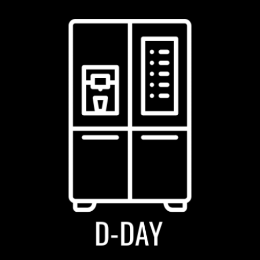
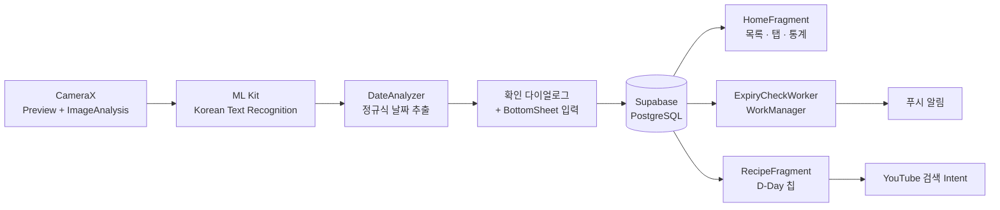

<p align="center">
  
</p>

<h1 align="center">FreshGuard</h1>
<p align="center">
  카메라로 유통기한을 스캔해 냉장고 속 식재료를 관리하고,<br/>
  임박한 재료는 푸시 알림과 유튜브 레시피로 연결해 주는 Android 앱
</p>

<p align="center">
  
  
  
  
  
  
</p>

---

## 📌 프로젝트 개요

| 항목 | 내용 |
|---|---|
| 기간 | 10주 |
| 담당 | 기획 · UI 설계 · Android 개발 · DB 설계 |
| 플랫폼 | Android (minSdk 24 / targetSdk 36) |
| 배경 | 웹 버전 FreshGuard(Supabase + Vercel 배포)를 네이티브 모바일 앱으로 이식 |

기존 유통기한 관리 앱은 이름·날짜·보관 위치를 **전부 직접 입력**해야 해서 오래 쓰기 어렵고,
알림을 줘도 **"그래서 이걸로 뭘 해 먹지?"** 에 대한 답이 없었습니다.
FreshGuard는 **카메라 스캔으로 입력을 자동화**하고, 임박 재료를 **바로 레시피로 연결**합니다.

## ✨ 주요 기능

| 기능 | 설명 |
|---|---|
| 📷 **실시간 유통기한 스캔** | CameraX 프리뷰 프레임을 ML Kit(한국어 텍스트 인식)로 분석, 정규식으로 날짜만 추출해 `YYYY.MM.DD`로 정규화 |
| ✅ **인식 결과 확인 → 등록** | 인식 날짜 확인/수정 다이얼로그 → BottomSheet에서 이름·수량·보관 위치(냉장/냉동) 입력 |
| 🧊 **냉장고 대시보드** | 유통기한 순 정렬 목록, 전체/냉장실/냉동실 탭, 전체·임박(3일 이하)·만료 개수 통계 |
| ✏️ **수정 · 스와이프 삭제** | 카드 탭 → 수정 BottomSheet, 좌우 스와이프로 삭제 (Supabase 즉시 반영) |
| 🔔 **백그라운드 임박 알림** | WorkManager `CoroutineWorker`가 주기적으로 DB를 확인해 3일 이하 재료가 있으면 푸시 알림 |
| ▶️ **유튜브 레시피 연결** | 재료별 D-Day 칩(임박 재료는 빨간색) → 탭하면 "OO 레시피" 유튜브 검색으로 이동 |

## 🖼️ 스크린샷

| 홈 | 스캔 | 레시피 | 알림 |
|:-:|:-:|:-:|:-:|
|  |  |  |  |

## 🏗️ 아키텍처



```
app/src/main/java/com/example/freshguard/
├── MainActivity.kt              # 스플래시, 하단 네비게이션, 알림 권한, Worker 등록
├── HomeFragment.kt              # 목록 · 탭 필터 · 대시보드 통계 · 스와이프 삭제
├── ScanFragment.kt              # CameraX + ML Kit 실시간 날짜 인식 (DateAnalyzer)
├── ScanResultBottomSheet.kt     # 스캔 결과 입력 → Supabase insert
├── EditIngredientBottomSheet.kt # 식재료 수정 → Supabase update
├── RecipeFragment.kt            # D-Day 칩 생성, 유튜브 검색 연결
├── SettingsFragment.kt          # 알림 on/off, 전체 데이터 삭제
├── ExpiryCheckWorker.kt         # 백그라운드 유통기한 체크 + 알림 채널
├── SupabaseManager.kt           # Supabase 클라이언트 싱글톤
└── Ingredient.kt                # @Serializable 데이터 모델
```

## 🛠️ 기술 스택

| 분류 | 기술 |
|---|---|
| Language / IDE | Kotlin, Android Studio |
| Camera / OCR | CameraX 1.3, Google ML Kit Text Recognition (Korean) |
| Backend | Supabase (PostgreSQL) · supabase-kt Postgrest, Ktor |
| Async / Background | Kotlin Coroutines, WorkManager (CoroutineWorker) |
| UI | Material Components (BottomNavigation, TabLayout, BottomSheet, Chip), RecyclerView, SplashScreen API |

## 🔧 트러블슈팅

<details>
<summary><b>1. 탭 간 데이터 불일치 — 삭제한 재료가 다른 탭에 남아 있음</b></summary>

- **원인**: 각 탭이 필터링된 리스트를 따로 참조해, 한 탭의 삭제가 원본 리스트에 반영되지 않음
- **해결**: 원본(`allIngredients`)을 단일 데이터 소스로 두고, 삭제 시 원본에서 ID로 제거한 뒤 현재 탭의 `filterListByTab()`을 다시 호출 → 모든 탭과 통계가 즉시 일치
</details>

<details>
<summary><b>2. 스플래시 추가 후 하단 네비게이션이 동작하지 않음</b></summary>

- **원인**: `onCreate`에서 `setContentView()`가 두 번 호출되어, 첫 번째 뷰에 달린 리스너가 새 뷰로 덮여 사라짐
- **해결**: 레이아웃 inflate를 1회로 정리하고, `registerForActivityResult`를 클래스 최상단 프로퍼티로 이동해 생명주기상 안전하게 등록
</details>

<details>
<summary><b>3. 카메라 프레임마다 팝업이 중복으로 뜸</b></summary>

- **원인**: ImageAnalysis가 초당 수십 프레임을 분석하면서 날짜를 찾을 때마다 팝업 호출
- **해결**: `isPopupShowing` 상태 플래그로 팝업이 떠 있는 동안 프레임 분석을 건너뛰고, 팝업이 닫히는 콜백에서 분석 재개 (`STRATEGY_KEEP_ONLY_LATEST` 병행)
</details>

<details>
<summary><b>4. Android 11(API 30)에서 상단바 색이 테마와 어긋남</b></summary>

- **원인**: SplashScreen API 하위 호환 제약 + 배경(#F8F9FA)과 상단바(#FFFFFF)의 미세한 색차
- **해결**: `windowLightStatusBar` 적용, 상단바·홈 배경을 `#FFFFFF`로 통일
</details>

<details>
<summary><b>5. AI(Gemini) 레시피 추천의 현실성 문제 → 유튜브 연결로 전환</b></summary>

- **현상**: 생성형 AI가 "젤리 무침", "당근 치즈 찌개"처럼 실제로 만들기 어려운 레시피를 제안
- **해결**: 레시피를 생성하지 않고, 재료명으로 유튜브 검색을 바로 열어 실제로 검증된 레시피 영상에 연결
</details>

## 🚀 실행 방법

1. 저장소 클론 후 Android Studio로 열기
2. `local.properties.example`을 참고해 프로젝트 루트의 `local.properties`에 Supabase 정보 추가
   ```properties
   SUPABASE_URL=https://YOUR_PROJECT_ID.supabase.co
   SUPABASE_KEY=YOUR_SUPABASE_PUBLISHABLE_KEY
   ```
3. Supabase에 `ingredients` 테이블 생성

   | 컬럼 | 타입 |
   |---|---|
   | id | int8 (PK, identity) |
   | name | text |
   | expiryDate | text (`YYYY.MM.DD`) |
   | location | text (`냉장실` / `냉동실`) |
   | quantity | text |
4. Run ▶ (실기기 권장 — 카메라 사용)

APK는 [Releases](../../releases)에서 받을 수 있습니다.

## 💭 회고

웹 서비스를 네이티브 앱으로 옮기면서 화면 구현보다 **생명주기 · 백그라운드 작업 · 상태 동기화**가 더 어렵다는 것을 체감했습니다.
특히 "AI가 만든 레시피"보다 "실제로 검증된 레시피로 연결"하는 쪽이 사용자에게 더 가치 있다는 판단으로 기능 방향을 바꾼 경험이 기억에 남습니다.

**향후 개선**: 사용자 인증(Supabase Auth) + RLS로 개인별 데이터 분리 · 알림 주기 하루 1회로 조정 · OCR 인식률 향상(초점 제어, 다양한 날짜 표기 대응)

